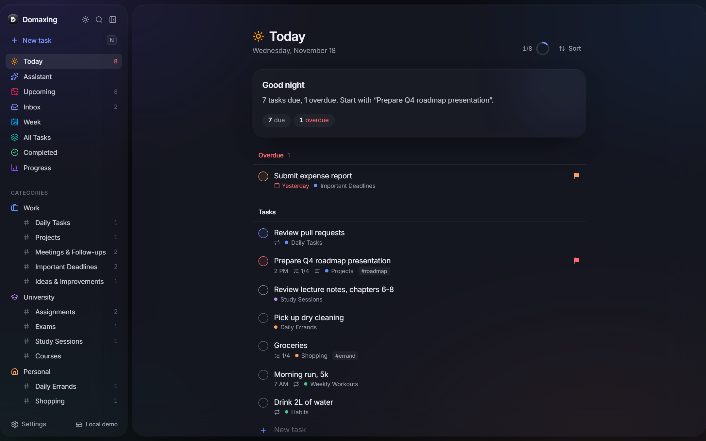
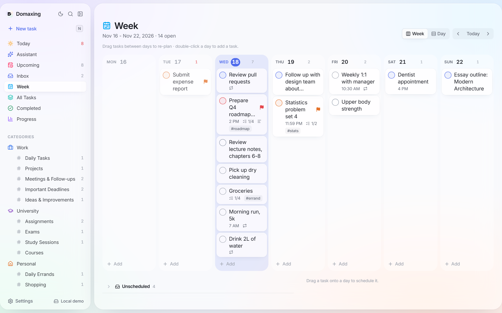
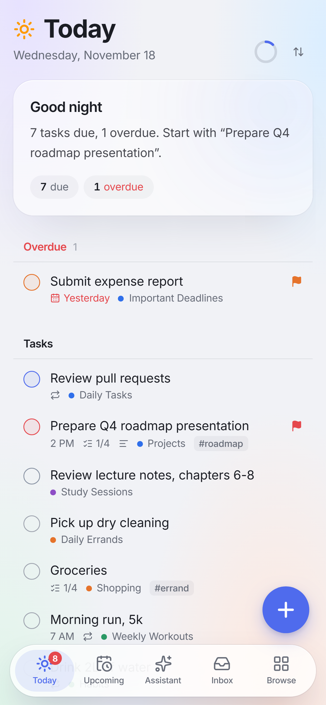
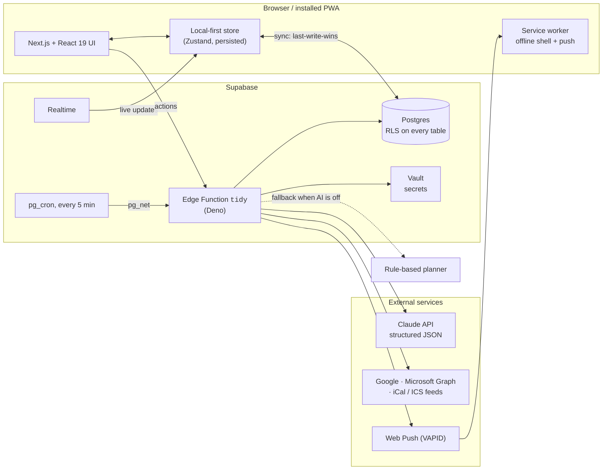

<div align="center">


# Domaxing

### *One day or day one. You decide.*

**A calm, local-first to-do app with a proactive AI planner.**
It reads your calendar, notices the exam, flight or interview coming up, and builds the preparation plan before you even think of it.

[](https://YanaAnnt.github.io/domaxing/)
[](https://github.com/YanaAnnt/domaxing/releases/latest)
[](https://github.com/YanaAnnt/domaxing/actions/workflows/ci.yml)
[](https://github.com/YanaAnnt/domaxing/actions/workflows/deploy.yml)


[**Try it**](#-try-it-in-10-seconds) · [**Download**](https://github.com/YanaAnnt/domaxing/releases/latest) · [**Engineering highlights**](#-engineering-highlights) · [**Features**](#-features) · [**Architecture**](#-architecture) · [**Run locally**](#-run-it-locally) · [**Roadmap**](#-roadmap)

<br />



</div>

<br />

## 💡 Why Domaxing?

Most to-do apps are passive. They wait for you to remember that the exam is in two weeks, that the passport might be expired, or that a birthday is on Saturday.

Domaxing looks ahead for you:

> 📅 *"Midterm: Microeconomics"* appears in your calendar 14 days out.
> 🧠 Domaxing proposes a study plan: gather materials, six revision sessions **placed on your lightest days**, a practice exam and a final review.
> ✅ You approve it in one tap. Nothing is ever added without your OK.

It does the same for flights, interviews, presentations, birthdays and deadlines, and when the event moves, it offers to move the prep with it.

<br />

## 🚀 Try it in 10 seconds

**[Open the live demo →](https://YanaAnnt.github.io/domaxing/)**

- Opens with realistic sample data, so there is something to play with right away.
- Runs in **Local Demo Mode**: everything stays in your browser, no account, no tracking. (The calendar assistant needs the cloud backend, see [Run it locally](#-run-it-locally).)
- **Prefer a real desktop app?** [Download the Windows installer](https://github.com/YanaAnnt/domaxing/releases/latest). It installs like any other program, with a Start Menu entry and desktop shortcut, and works fully offline. *(The installer is not code-signed yet, so if SmartScreen appears, click **More info → Run anyway**.)*
- **Or install the web app**: in Chrome or Edge, click the install icon in the address bar. On iPhone, open it in Safari, then Share → *Add to Home Screen*. It launches in its own window and **keeps working offline**.

| Desktop, light | iPhone |
|---|---|
|  |  |

<br />

## 🛠 Engineering highlights

The parts I am most proud of, and the problems behind them:

| Challenge | How Domaxing solves it |
|---|---|
| **The UI must feel instant, even offline** | A **local-first** store (Zustand, persisted) is the source of truth. Every edit applies immediately, then syncs to Postgres in the background with last-write-wins on `updatedAt`, plus **realtime** updates from other devices. |
| **AI must never break the product** | Claude returns **schema-validated JSON**. If the model is unavailable, refuses, or no key is configured, a **deterministic rule-based planner** takes over, so the assistant always works. |
| **AI must never act on its own** | Every plan lands in a **human-in-the-loop** inbox: approve, edit (rename, re-date, untick steps, choose the list) or dismiss. The database itself enforces that users can only approve or dismiss suggestions, never forge them. |
| **Real-world calendars are messy** | ICS parsing with **timezones, DST and recurrence** (ical.js), Google Calendar API and Microsoft Graph, OAuth with **HMAC-signed state**, and an **SSRF guard** that rejects private-network feed URLs. |
| **Background work without running a server** | `pg_cron` → `pg_net` → a Deno **Edge Function** every 5 minutes: reminders, nudges, daily briefings, calendar refresh and planning, all respecting **quiet hours and a daily push cap**. |
| **Secrets must never reach the browser** | **Row Level Security** on every table, **column-level grants** that hide OAuth tokens and feed URLs, and all keys stored in **Supabase Vault**, readable only by the service role. |
| **The code must stay safe after launch** | **CodeQL** scans the app, the edge function and the CI workflows on every pull request and weekly, and **Dependabot** opens grouped update PRs for npm packages and GitHub Actions, which the CI checks like any other change. |
| **One codebase, three platforms** | The whole frontend exports to **static HTML**. GitHub Actions type-checks, tests and deploys it to GitHub Pages on every push, a service worker makes it an **offline-capable PWA** for iPhone and desktop, and the same build is wrapped by **Electron** into a Windows installer that a tagged release builds and publishes automatically. |
| **Correctness** | **Vitest** suites cover the planner, timezone/DST handling and the ICS parser. CI type-checks, tests and builds **every pull request** before it can be merged, and runs again before every deploy. TypeScript runs in `strict` mode across the app and the edge function. |

<br />

## ✨ Features

<details open>
<summary><b>📋 Organize everything</b></summary>
<br />

- Unlimited **categories** (Work, University, Personal, Fitness...) with their own color and icon
- **Lists** inside categories and **sections** inside lists. Tasks can also live in a category or the Inbox
- Smart views: **Today**, **Assistant**, **Upcoming**, **Inbox**, **Week**, **All Tasks** (with filters), **Completed**, **Progress**
- An interactive **Week planner** with three layouts: a **Time** grid (tasks sit at their hour, tasks without a time sit in an All day row, click an empty slot to add a task at that day and time, drag a task to a new slot), a **Board** with a column per day, and a one-day **List**. Swipe between weeks on mobile
- Rich tasks: notes, due date and time, 4 priority levels, subtasks, tags, reminders, recurrence, duplicate, undo and **Focus mode**
- **Drag and drop** everywhere: reorder categories, lists and tasks, or drop a task on the sidebar to move it
- **Natural-language Quick Add**: `Call Anna tomorrow at 3pm !high #calls @personal`
- **Command menu** (⌘/Ctrl K) and full keyboard control

</details>

<details open>
<summary><b>🧠 The proactive assistant</b></summary>
<br />

- **Calendar sync** with Google Calendar, Outlook, Apple iCloud and any iCal/webcal feed (school timetables, sports fixtures...), refreshed every 30 minutes
- **Preparation plans, created ahead of time:**
  - 🎓 **Exams**: materials, study plan, revision sessions, practice exam, final review (from 14 days ahead)
  - ✈️ **Trips**: documents and visa, reservations, airport transport, packing, check-in (from 30 days ahead)
  - 💼 **Meetings, interviews, presentations**: agenda, talking points, final prep (from 3 days ahead)
  - 🎁 **Birthdays**: pick and buy a gift, write a card, send wishes on the day (from 7 days ahead)
  - 📝 **Deadlines**: start, draft, final check
- **Load-aware scheduling**: prep steps go on your **least busy days**, counting both tasks and calendar hours
- **Smart rescheduling**: if an event moves, Domaxing offers to move the prep. If it is cancelled, it offers to remove it
- **Daily briefing** on the Today screen, and optionally as a morning push notification
- **"Break it down with AI"** turns any vague task into concrete steps you can pick from
- **Respectful notifications** that arrive even when the app is closed (Web Push), with quiet hours and a daily cap
- **Meet Max, your Domaxing buddy**: the Assistant is a clean, full-screen chat (with the calendar Planner one switch away). One tap on **Brief me** and Max sums up today, shows which days ahead are heavy or light, and points out what's coming that needs preparing, like an exam or a race. When something needs preparing, Max drafts the tasks as cards: tap **Add** or **Skip** on each, or **Add all**. Nothing is added without you, and every choice can be undone
- **Chat with the assistant**: describe your plans in your own words, in any language, and the reply streams in as it is written. Ask "what should I focus on today?" and it looks at your tasks, lists and calendar before answering, showing what it looked at. It only reads; nothing changes without you. The conversation is saved on your device only, separately from your tasks
- **Bring your own AI key**: paste an Anthropic API key in *Settings → AI assistant*, pick a model (Claude Opus 5.5 is recommended), and check it with one click. The key stays on your device and goes only to Anthropic, so there is no account and no Domaxing server involved

</details>

<details open>
<summary><b>🎨 Design: "Soft Glass"</b></summary>
<br />

- Frosted, translucent panels floating over a soft pastel canvas, inspired by Apple's Liquid Glass and visionOS
- Light and dark themes plus 8 accent colors, applied before first paint so there is never a flash
- **Desktop**: floating glass sidebar, workspace and detail panel
- **iPhone**: a minimal dashboard with a floating tab bar, bottom-sheet composer and swipe gestures
- Every launch opens with the line that names the app: *"One day or day one. You decide."*

</details>

<br />

## 🏗 Architecture



**How a suggestion is born:** the cron job refreshes calendars → new events inside their preparation window are classified (exam, trip, meeting, birthday, deadline) → Claude, or the rule planner as a fallback, drafts the steps → the planner spreads them across your lightest days → the suggestion waits in your Assistant inbox until you decide.

**AI cost control:** Claude is only called for *new* events inside their preparation window (batched up to 12 at a time), once a day for the briefing, and when you tap "Break it down". Events it has already reviewed are remembered.

<br />

## 🧰 Tech stack

| Layer | Technology |
|---|---|
| Frontend | Next.js 16 (App Router, static export), React 19, TypeScript (strict), Tailwind CSS 4 |
| State | Zustand with persistence, local-first sync engine |
| UI building blocks | Radix UI (dialog, popover, dropdown), cmdk, dnd-kit, lucide icons, date-fns |
| Backend | Supabase: Postgres, Row Level Security, Realtime, Auth, Vault, pg_cron, pg_net |
| Server logic | Supabase Edge Function in Deno: calendar sync, planner, AI, briefings, Web Push |
| AI | Anthropic Claude with structured outputs, with a rule-based fallback |
| Testing and CI | Vitest, GitHub Actions on every pull request (type-check, tests, build) |
| Delivery | GitHub Actions → GitHub Pages, installable PWA with a service worker |
| Desktop | Electron with a private `app://` origin and a sandboxed renderer, packaged by electron-builder into an NSIS installer |
| Security and maintenance | CodeQL (security-and-quality queries), Dependabot for npm and GitHub Actions |

<br />

## 💻 Run it locally

```bash
git clone https://github.com/YanaAnnt/domaxing.git
cd domaxing
npm install
npm run dev
```

Open http://localhost:3000. With no configuration the app starts in **Local Demo Mode**: every feature that does not need a server works, and data stays in your browser.

| Command | What it does |
|---|---|
| `npm run dev` | Development server |
| `npm run build` / `npm start` | Production build and server |
| `STATIC_EXPORT=1 npm run build` | Static site in `out/` (what GitHub Pages serves) |
| `npm run desktop` | Build and open the desktop app (its data stays in `.desktop/` inside the project) |
| `npm run desktop:build` | Windows installer in `dist-desktop/` |
| `npm run lint` | Type-check the app |
| `npx tsc -p supabase/functions/tsconfig.json` | Type-check the edge function |
| `npm test` | Unit tests (Vitest): planner, timezones, ICS parser |
| `npm run test:watch` | Tests in watch mode while you work |

<details>
<summary><b>☁️ Enable cloud sync, the assistant and push notifications</b></summary>
<br />

1. Create a Supabase project. In the SQL editor run `supabase/schema.sql`, then `supabase/schema-v2-assistant.sql` (replace `YOUR-PROJECT-REF` in the cron block at the end first).
2. Deploy the edge function: `npx supabase functions deploy tidy --no-verify-jwt --project-ref <ref>`. It authenticates every request itself.
3. Create the Vault secrets `vapid_public_key` and `vapid_private_key` (generate them with `npx web-push generate-vapid-keys`), plus `cron_secret` and `oauth_state_secret` (any long random strings).
4. Copy `.env.example` to `.env.local` and fill in your project URL, publishable key and VAPID public key.
5. **Optional, AI:** add an `ANTHROPIC_API_KEY` secret to the edge function. Without it, the rule-based planner is used.
6. **Optional, one-click calendar sign-in:** add `GOOGLE_CLIENT_ID` / `GOOGLE_CLIENT_SECRET` (scope `calendar.readonly`) and `MICROSOFT_CLIENT_ID` / `MICROSOFT_CLIENT_SECRET` (`Calendars.Read`, `User.Read`, `offline_access`). The redirect URI is `https://<ref>.supabase.co/functions/v1/tidy/oauth/callback`. Calendar *links* (ICS) work without any of this.

</details>

<details>
<summary><b>🌍 Deploy your own copy</b></summary>
<br />

**GitHub Pages (free, already wired up):** fork the repo, then go to *Settings → Pages* and set the source to **GitHub Actions**. Every push to `main` type-checks, tests and deploys. To turn on cloud sync in the hosted version, add `NEXT_PUBLIC_SUPABASE_URL`, `NEXT_PUBLIC_SUPABASE_ANON_KEY` and `NEXT_PUBLIC_VAPID_PUBLIC_KEY` as repository *variables*, and add the site URL to Supabase *Authentication → URL Configuration*.

**Vercel:** import the repo at [vercel.com/new](https://vercel.com/new) and add the same environment variables. No other changes needed.

</details>

<br />

## 📁 Project structure

```
app/                      Next.js shell, PWA manifest, "Soft Glass" design tokens
components/
  app.tsx                 Layout, hash routing, keyboard shortcuts, service worker wiring
  views/                  Today, Assistant, Upcoming, Inbox, Week, All, Completed, Progress...
  assistant-ui.tsx        Suggestion cards (approve / edit / dismiss), briefing, calendar connect
  task-detail.tsx         Task editor, AI breakdown, subtasks, reminders, recurrence
  ...                     Sidebar, mobile tab bar, quick add, command menu, dialogs
lib/
  store.ts, sync.ts       Local-first store and the Supabase sync engine
  parse.ts                Natural-language Quick Add parser
  assistant.ts            Assistant client: realtime, approvals, push subscription
  ai/                     Bring-your-own-key AI: model list, key store, Anthropic client, chat, tools and task suggestions
supabase/
  schema.sql              Tasks, categories, lists, RLS
  schema-v2-assistant.sql Assistant, calendars, push, Vault access, cron
  functions/tidy/         Edge function: calendar, ics, planner, ai, briefing, push, cron
electron/
  main.cjs                Desktop shell: app:// protocol, single instance, external links in the browser
tests/                    Vitest suites: planner, time zones, ICS parser
scripts/
  build-desktop.mjs       Static export + Windows installer
.github/workflows/        ci.yml: checks every PR · deploy.yml: main → GitHub Pages · release-desktop.yml: tag → Windows installer
```

<br />

## ⌨️ Keyboard shortcuts

| Keys | Action |
|---|---|
| `⌘/Ctrl K` | Command menu and search |
| `N` | New task |
| `↑` `↓` / `Enter` | Move selection / open task |
| `X` | Complete task |
| `F` | Focus mode |
| `Alt ↑` `Alt ↓` | Reorder |
| `G` then `T` `S` `U` `I` `W` `A` `C` `P` | Go to Today, Assistant, Upcoming, Inbox, Week, All, Completed, Progress |
| `?` | Show all shortcuts |

<br />

## 🗺 Roadmap

Domaxing is growing into an **AI assistant you can talk to**: tell it your plans in your own words, run big projects with it, add a training plan as text or a file, and it turns everything, together with your calendar, into tasks and reminders you approve.

**How work ships.** Every item below is its own small pull request that passes CI and updates this README and the [changelog](CHANGELOG.md). Items are grouped into versions that follow [Semantic Versioning](https://semver.org/). When a version is complete it is tagged (`v1.1.0`, …), which builds the Windows installer and publishes a [GitHub Release](https://github.com/YanaAnnt/domaxing/releases) whose notes come from the changelog.

**v1.0.0: First release** (shipped)
- [x] Tasks, lists, Today, Week, Progress, the Assistant, cloud sync and the Windows app
- [x] Vitest suites and CI on every pull request ([#1](https://github.com/YanaAnnt/domaxing/pull/1))
- [x] CodeQL security scanning and Dependabot updates ([#2](https://github.com/YanaAnnt/domaxing/pull/2))
- [x] Public roadmap and changelog ([#6](https://github.com/YanaAnnt/domaxing/pull/6))

**v1.1.0: Talk to your assistant** (in progress)
- [x] AI settings: paste your own Anthropic key, choose a Claude model, test the connection ([#8](https://github.com/YanaAnnt/domaxing/pull/8))
- [x] Chat with the assistant, with streamed replies and history saved on your device ([#10](https://github.com/YanaAnnt/domaxing/pull/10))
- [x] The assistant can read your tasks, today's plan and your calendar ([#11](https://github.com/YanaAnnt/domaxing/pull/11))
- [x] The assistant can suggest tasks, each one shown as a card you add or skip ([#13](https://github.com/YanaAnnt/domaxing/pull/13))
- [x] Daily brief: tap **Brief me** and Max sums up today, the days ahead and what to prepare for ([#12](https://github.com/YanaAnnt/domaxing/pull/12), [#13](https://github.com/YanaAnnt/domaxing/pull/13))
- [x] A collapsible **Completed** section at the bottom of every list, category and the Inbox ([#18](https://github.com/YanaAnnt/domaxing/pull/18))
- [x] Week as a time grid: tasks sit at their time, and clicking an empty slot adds a task at that day and hour ([#19](https://github.com/YanaAnnt/domaxing/pull/19))
- [ ] Reminders as desktop and browser notifications
- [ ] End-to-end tests with Playwright for the main flows, run in CI

**v1.2.0: Projects**
- [ ] Projects for big goals, such as a wedding, a home renovation, starting a business or a project at work, each with a deadline and a progress bar showing what is done and what is left
- [ ] A project log: notes on what was done and who you spoke to, with each person kept as a contact on the project
- [ ] Board and table views for a project's tasks (To do / Doing / Done)
- [ ] Ready-made project templates, such as a wedding or a renovation
- [ ] The assistant can plan a project from one sentence, such as "I'm getting married in June", into milestones and tasks you approve
- [ ] Guest mode: try the assistant through a scripted conversation, no sign-up and no key

**v1.3.0: Training plans**
- [ ] Paste a training plan as text and preview the schedule it becomes
- [ ] Upload a plan as a file: text, CSV, PDF or image
- [ ] Workouts in Today and Week, with reminders and warnings when they clash with your calendar

**v2.0.0: Cloud**
- [ ] Chat in the cloud, with long-term memory and your connected calendars
- [ ] Reminders pushed from the server, even when the app is closed
- [ ] The hosted demo connected to its own Supabase project
- [ ] Lighthouse scores measured in CI and shown in this README

**Later**
- Voice: speak to the assistant and have the daily brief read aloud
- A mobile app, with an optional paid plan that includes managed AI
- A code-signed installer with automatic updates, plus macOS and Linux builds
- Two-way calendar sync, so approved prep sessions appear in your calendar too
- Shared lists for families and study groups

<br />

<div align="center">

Built by **[@YanaAnnt](https://github.com/YanaAnnt)**. If Domaxing gave you an idea, a ⭐ is always appreciated.

</div>
